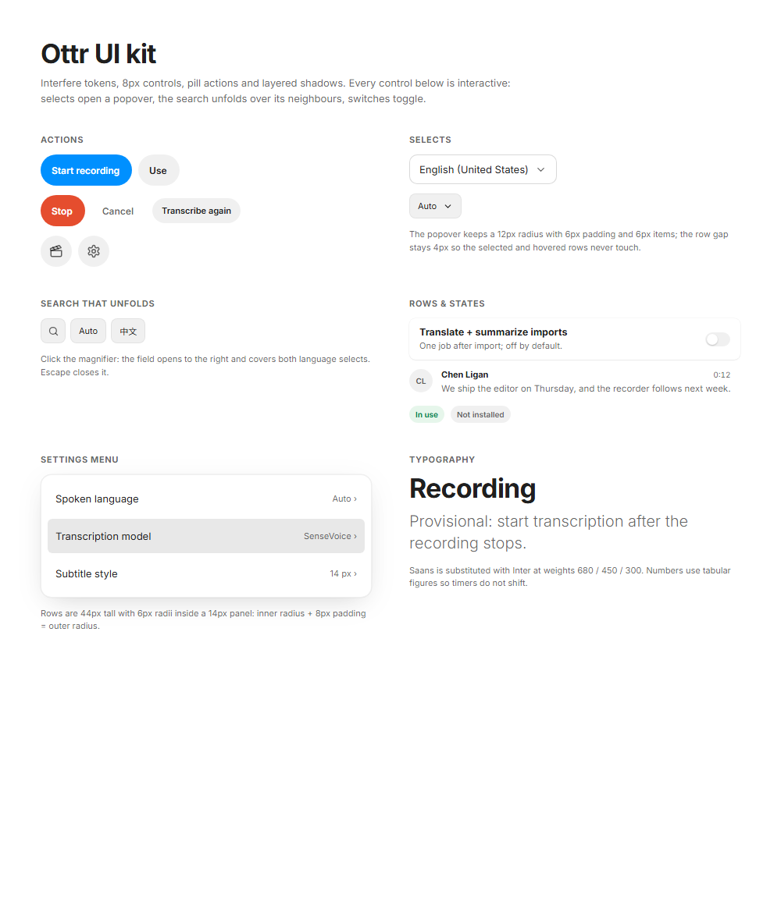

# Ottr UI design reference

Static snapshots of the Ottr desktop UI, plus the tokens and component code they are built from.
These pages are **design references only** — the shipped app is native Go/MyGo in [`internal/native`](../../internal/native)
and never renders HTML. Use this folder to check spacing, colour and state behaviour, then mirror
the change in Go.



## Screens

Open any file in `pages/` in a browser. Each one is a single self-contained document.

| Screenshot | Page | Size | What it shows |
| --- | --- | --- | --- |
| `01-recorder.png` | `01-recorder.html` | 1280×800 | Empty recorder, library panel open |
| `02-playback.png` | `02-playback.html` | 1280×800 | Playback with transcript, player controls |
| `03-playback-dark.png` | `03-playback-dark.html` | 1280×800 | Same screen, dark theme |
| `04-recording.png` | `04-recording.html` | 1280×800 | Live recording, pause/stop in the header, red clock pill |
| `05-library.png` | `05-library.html` | 1280×800 | Library grid view |
| `06-settings-speakers.png` | `06-settings-speakers.html` | 920×1050 | Global speaker names |
| `07-settings-appearance.png` | `07-settings-appearance.html` | 920×660 | Language, display font, theme |
| `08-settings-transcription.png` | `08-settings-transcription.html` | 920×1050 | Models, download states, subtitle options |
| `09-settings-provider.png` | `09-settings-provider.html` | 920×1050 | ASR/LLM provider and prompt templates |
| `10-recorder-900.png` | `10-recorder-900.html` | 900×620 | Recorder without the library panel |
| `11-recorder-420.png` | `11-recorder-420.html` | 420×800 | Narrow recorder, single column |
| `12-playback-900.png` | `12-playback-900.html` | 900×620 | Playback without the library panel |
| `13-playback-420.png` | `13-playback-420.html` | 420×800 | Narrow playback |
| `14-search-open.png` | `14-search-open.html` | 1280×800 | Transcript search unfolded over the language selects |

Layout rule in the app: the library panel is visible at **≥ 840 DIP**, the 900×620 shell is used
from 840 to 1100 DIP, and below ~560 DIP the panels stack into the 420×800 layout.

## Tokens

[`tokens.css`](tokens.css) carries the Interfere palette for light and dark. The values that matter
when implementing in Go:

| Token | Light | Dark |
| --- | --- | --- |
| Page | `#ffffff` | `#000000` |
| Surface / component | `#0000000f` | `#ffffff12` |
| Hover | `#00000017` | `#ffffff1b` |
| Border | `#0000000f` | `#ffffff12` |
| Strong border | `#00000026` | `#ffffff2c` |
| Text primary | `#000000df` | `#ffffffed` |
| Text secondary | `#0000009b` | `#ffffffaf` |
| Text tertiary | `#00000072` | `#ffffff64` |
| Brand | `#0090ff` | `#0090ff` |
| Brand hover | `#0588f0` | `#3b9eff` |
| Danger | `#e54d2e` | `#e54d2e` |
| Positive | `#008647` | `#43fea4` |

Radii: 2 / 4 / 6 / 8 / 10 / 12 / 16 / 20 / 24 / full. Controls use **8**, media frames **16**,
popovers **12** with 6px padding and 6px items (inner radius + 8 = outer radius).

Shadows: `--shadow-default` for cards, `--shadow-large` for the library panel,
`--shadow-extra-large` for popovers and menus.

Typography: Inter (Saans substitute) at 680 / 450 / 300; numbers use tabular figures; body text
13px, secondary 11–12px, section labels 10px uppercase at 0.06em.

## Components

[`components.css`](components.css) + [`example.html`](example.html) (screenshot `00-components.png`)
cover the pieces used in more than one screen: pill buttons, icon buttons, the white and filled
selects, the popover, the settings menu, the unfolding search, switches, setting rows, badges,
and the speaker row.

Two rules that are easy to get wrong:

- **Selects**: the Appearance selects are white with a `#00000026` border, 38px tall, 10px radius,
  13px text, value left and chevron right. The in-line selects (language, subtitle size) stay filled
  and 32px tall.
- **Search**: collapsed it is a 32px icon button; expanded it becomes an absolutely positioned field
  that starts at the button and stretches over the controls to its right, with a default shadow.

## Regenerating screenshots

Pages and screenshots are rebuilt from the local generators with one command (needs node
and the gitignored `.doop/` folder):

```bash
node .agents/skills/doop-canvas/scripts/build.js --shots
```

Set `DOOP_BROWSER` to a Chromium/Edge executable if it is not found automatically. A single
page can also be rendered directly:

```bash
msedge --headless=old --hide-scrollbars --virtual-time-budget=5000 \
  --window-size=1280,800 --screenshot=docs/design/screens/01-recorder.png \
  "file:///C:/Projects/github/ottr/docs/design/pages/01-recorder.html"
```

The three settings pages override the 660px shell height so the full page is captured. The two 420px pages pin `html, body` to 420px because Chromium will not lay out below ~500px;
1000px examples are fine at their natural width.

## Mapping to the Go implementation

| Design | Go |
| --- | --- |
| Recorder, recording, library panel | [`recorder.go`](../../internal/native/recorder.go) |
| Playback, transcript, player controls | [`session.go`](../../internal/native/session.go), [`player.go`](../../internal/native/player.go) |
| Library list/grid, empty first run, thumbnails | [`library.go`](../../internal/native/library.go), [`thumbnail.go`](../../internal/native/thumbnail.go) |
| Recorder details card, day groups | [`details.go`](../../internal/native/details.go) |
| Transcribing after Stop | [`transcribing.go`](../../internal/native/transcribing.go) |
| Playback · Summary | [`session.go`](../../internal/native/session.go) (`summaryTab`) |
| Dialogs: delete, export, transcription failed | [`dialogs.go`](../../internal/native/dialogs.go) |
| Settings pages | [`settings.go`](../../internal/native/settings.go) |
| Settings menu | [`settings_menu.go`](../../internal/native/settings_menu.go) |
| Shared controls (select, switch, rows) | [`kit/kit.go`](../../internal/native/kit/kit.go) |
| Colours, radii, shadows | [`theme.go`](../../internal/native/theme.go) |
| Strings | [`i18n.go`](../../internal/native/i18n.go) |
